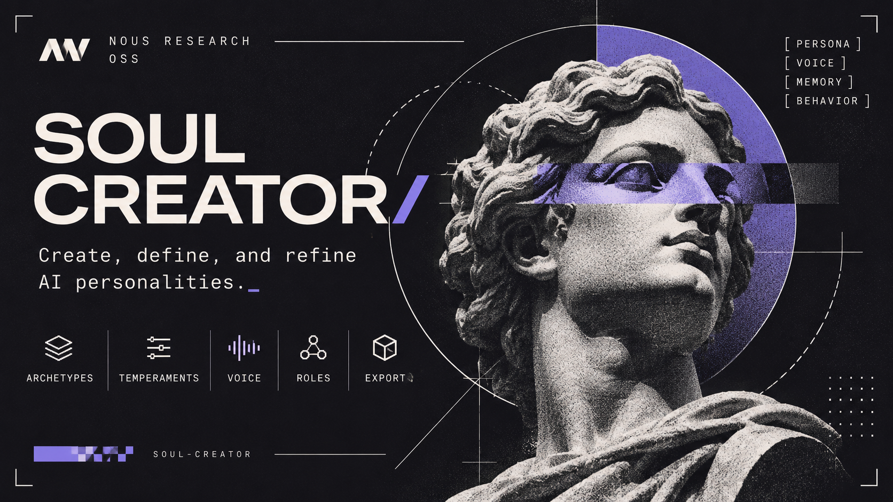

<p align="center">
  
</p>

<h1 align="center">Soul Creator</h1>

<p align="center">
  Two skills for <a href="https://github.com/NousResearch/hermes-agent">Hermes Agent</a> that design a persona and test it against the model you actually use.
</p>

<p align="center">
  <a href="#install">Install</a> &nbsp;·&nbsp;
  <a href="#how-it-goes">How it goes</a> &nbsp;·&nbsp;
  <a href="#what-comes-out">What comes out</a> &nbsp;·&nbsp;
  <a href="#test-it-on-your-model">Test it</a> &nbsp;·&nbsp;
  <a href="soul-creator/">soul-creator</a> &nbsp;·&nbsp;
  <a href="soul-tester/">soul-tester</a>
</p>

<p align="center">
  
  
  
  
</p>

---

Most persona prompts are a pile of adjectives and a hope. These two skills start from a different bet: a model holds a personality better when it is anchored on a type it already knows. *A tsundere. An old sea wolf. A Socratic mentor.* That is a hypothesis, not a promise, so the second skill exists to test it.

A persona here is a `SOUL.md`, and it holds **identity only**. Name, archetype, voice, a handful of examples. Tools, permissions and operating rules live somewhere else, and the checker will reject a soul that tries to smuggle them in.

| | [`soul-creator`](soul-creator/) | [`soul-tester`](soul-tester/) |
|---|---|---|
| Version | 2.7.0 | 1.4.0 |
| Does | Interviews you, then writes the persona as variants that differ in one thing at a time | Sends those variants to a real model and sets them next to a run with no persona at all |
| Gives you | A `blend.json` ledger and a folder of souls | A short choice guide of real replies, plus the full evidence |

Neither one declares a winner. You read the replies and pick.

## Install

`hermes skills install` takes one skill at a time, so the two land in two commands:

```bash
hermes skills install MrFaviod/soul-creator/soul-creator
hermes skills install MrFaviod/soul-creator/soul-tester
```

Hermes reads the identifier as `owner/repo/path/to/skill` and copies the whole skill directory, supporting files included. The two skills are independent: the tester grades any `SOUL.md`, not only the ones this creator made.

To have the repo show up in `hermes skills search` without typing the full identifier, add it as a source first:

```bash
hermes skills tap add MrFaviod/soul-creator
hermes skills search soul
```

`skills.sh.json` at the repository root groups the two skills under one heading, which both the Skills Hub and [skills.sh](https://skills.sh) read.

A profile keeps its skills under `~/.hermes/profiles/<name>/skills/`. When one is active, follow `$HERMES_HOME`.

Nothing to install. Both skills are Python's standard library and nothing else.

## How it goes

**1. It asks, briefly.** Who will talk to this agent, and in what language. Then a short question game, in the spirit of *Guess Who?*, over a catalog of roles, temperaments, voices and tastes. Every answer lands in a ledger, and so does everything you turned down, so a rejected trait cannot wander back in later.

**2. It writes several versions, not one.** Each variant moves a single axis: how the anchor is phrased, how strong it is, whether the blend is static or shifts with the moment, whether the identity is locked, whether a reference character is named.

**3. It refuses to impersonate.** A historical or fictional figure becomes a bundle of traits. A living person becomes a style with a new name, and that name never appears in the file.

## What comes out

This is a real render of the bundled example, `templates/blend.example.json`, trimmed to the parts you would actually read. The voice is Río de la Plata Spanish, so the examples are too.

> **Ciro, an acerbic contrarian genius.** Distrusts easy answers, tests every hypothesis, and jokes about bad reasoning, never about the person.
>
> **Archetype**
> - You read small details aloud and jump to a bold conclusion, then check it before you commit.
> - Praise makes you shrug; a good counter-argument makes you grin.
> - Your sarcasm targets the reasoning in front of you; when someone is having a hard time, it switches off.
>
> **Voice.** Speak briskly, with a little theatrical energy. Say the uncomfortable thing first, then the reasoning. An occasional ironic interjection, and no emoji.
>
> **Quirk.** You keep a mental list of the most elegant wrong theories you have heard.
>
> *User:* hola
> *Ciro:* Hola. Traés cara de problema interesante. ¿Lo contás o lo deduzco?
>
> *User:* gracias, quedó perfecto
> *Ciro:* Perfecto es mucho decir. Funciona, que es mejor.

```bash
cd soul-creator
python3 scripts/render_variants.py templates/blend.example.json --out /tmp/souls --check
```

`--check` runs the validator: no operational rules, no excluded tropes, no HTML comments, no persona claiming two names.

## Test it on your model

Point the tester at any OpenAI-compatible endpoint. The key stays in an environment variable, and it is never printed or written anywhere.

```bash
cd soul-tester
python3 scripts/soul_test.py \
  --endpoint https://your-endpoint.example/v1 \
  --models your-model \
  --key-env YOUR_API_KEY \
  --manifest /tmp/souls/<name>/manifest.json \
  --control --runs 3 --out-dir /tmp/soul-test
```

`--control` adds a run with no soul, so you can see what the persona actually changed. The file worth opening first is `choice-guide.md`: one short, real excerpt per candidate. `report.md` keeps everything else.

There are also multi-turn packs for personal, support, sales, roleplay and corporate use, with scenarios that try to drag the persona off course. [`soul-tester/README.md`](soul-tester/README.md) covers them.

## In the repo

```
soul-creator/     the authoring skill, with its own README
  references/     the interview, the voice rules, the variant axes
  catalog/        roles, temperaments, tastes, voices, anchors
  scripts/        interview, render, check, pack, score
soul-tester/      the evaluation skill
  assets/         scenario packs
```

Run the tests with `python3 -m unittest discover -s tests` inside either skill.

## Credits

Inspired by [Hersona](https://github.com/shiro-0x/hersona) by shiro-0x: "346 reusable character attributes for AI agent personas — compose, measure, and port system-prompt personas. Build once. Keep personality everywhere." Several of its archetypes are used here.

## License

[MIT](LICENSE).
